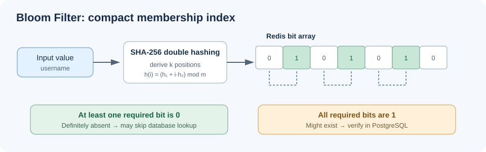
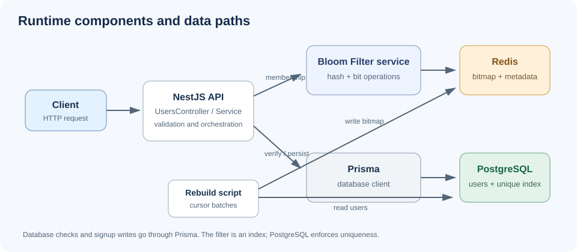

# Bloom Filter — System Design Lab

*A practical probabilistic data structure for optimizing username existence checks with NestJS, Redis, and PostgreSQL.*

## Introduction

This project explores how a Bloom Filter can reduce unnecessary database existence queries in a username registration flow. The filter is a compact probabilistic index: it can rule out a username quickly, while PostgreSQL remains responsible for authoritative answers and enforcing uniqueness.

It is a hands-on system design and backend engineering lab. The code demonstrates Bloom Filter mathematics, hashing and bit operations, Redis integration, database constraints, failure handling, Docker networking, and the trade-offs involved in adding an optimization to an otherwise direct database lookup.

## The problem

An application may check whether a username exists whenever a user types it or submits a registration form. A straightforward implementation asks PostgreSQL for each check. This is often perfectly reasonable, but at high request volumes it can add repeated database queries, connection and query overhead, and avoidable work for names that are definitely absent.

The goal here is not to claim that PostgreSQL lookups are inherently slow. It is to demonstrate a filter that can answer some negative membership checks without querying the database.

## Why a Bloom Filter?

A Bloom Filter is a space-efficient probabilistic structure for testing set membership. It has two useful answers:

- **Definitely absent:** at least one required bit is unset, so the value was not inserted (assuming the filter is correctly initialized and maintained).
- **Might exist:** all required bits are set. This can be a false positive, so the source of truth must verify the result.

The filter does not produce false negatives under correct initialization and maintenance. Since false positives only cause an extra PostgreSQL lookup, the structure can safely optimize this availability check when readiness and failure states are handled carefully.

## How this project works

1. The rebuild script reads existing usernames from PostgreSQL in batches.
2. SHA-256 based double hashing calculates positions in a bit array stored in Redis.
3. The availability endpoint checks readiness and queries the Bloom Filter.
4. A trustworthy negative means the username is available without a database lookup.
5. A possible match is verified in PostgreSQL.
6. If Redis or the filter is unavailable, the request falls back to PostgreSQL.
7. Signup writes to PostgreSQL first; a unique database constraint remains authoritative.



## Key features

- Custom Bloom Filter and SHA-256 double-hashing implementation in TypeScript.
- Configurable bit-array size and hash count.
- Redis bit-array storage using `SETBIT` and `GETBIT` pipelines.
- Redis metadata for version, parameters, algorithm, and readiness state.
- PostgreSQL and Prisma as the persistent source of truth.
- Username availability (`GET`) and signup (`POST`) endpoints.
- Database uniqueness enforcement and duplicate-to-HTTP-409 mapping.
- Explicit, batch-based filter rebuild command.
- PostgreSQL fallback when Bloom Filter lookup is unavailable.
- Docker Compose setup for the API, PostgreSQL, and Redis.
- Unit tests and local in-memory experiments.

## Technology stack

| Technology | Role in this project |
|---|---|
| Node.js | JavaScript runtime (Docker image uses Node 22) |
| TypeScript | Application and experiment source language |
| NestJS | HTTP API and dependency-injected application modules |
| PostgreSQL | Persistent users table and authoritative uniqueness constraint |
| Prisma | PostgreSQL client and migration runner |
| Redis | Shared Bloom Filter bits and readiness metadata |
| ioredis | Redis client used by the backend |
| Docker / Docker Compose | Build and run the services with internal networking and volumes |
| Jest | Unit and end-to-end test framework |
| Supertest | HTTP assertions in the existing end-to-end test |

## Architecture overview

The client talks to the NestJS API. The Users module coordinates availability checks and signup. The Bloom Filter service reads and writes the Redis bitmap and metadata. Prisma talks to PostgreSQL, which stores users and enforces unique usernames. The rebuild script repopulates Redis by paging through PostgreSQL.



## Project structure

```text
bloom-filter/
├── README.md
├── backend/
│   ├── src/bloom-filter/    # Filter, hashing, Redis adapter, experiments
│   ├── src/users/           # Availability and signup endpoints
│   ├── src/redis/           # Redis client lifecycle and connection state
│   ├── src/prisma/          # Prisma service and module
│   ├── prisma/              # Schema and database migrations
│   └── test/                # Nest end-to-end test
├── infrastructure/          # Docker Compose services
└── docs/                    # Learning guides, measurements, and diagrams
```

`tests/` is not a separate project directory in the current checkout; tests are under `backend/src/**/*.spec.ts` and `backend/test/`.

## Bloom Filter configuration

| Parameter | Value |
|---|---:|
| Expected elements | 100,000 |
| Target false-positive probability | 1% |
| Bit-array size | 958,506 bits |
| Hash functions / positions | 7 |
| Approximate bitmap size | 117 KiB |

These are initial design parameters, not universal constants. The bit size and hash count are configured with `BLOOM_FILTER_BIT_SIZE` and `BLOOM_FILTER_HASH_COUNT`. As insertions approach or exceed the planned capacity, saturation and false-positive probability rise.

## Getting started

### Prerequisites

- Git
- Docker with Docker Compose
- Node.js and npm only if you want to develop or run scripts locally

### Clone the repository

```bash
git clone https://github.com/abbas-shahid/system-design-lab.git
cd system-design-lab/01-fundamentals/bloom-filter
```

### Start the application

```bash
docker compose -f infrastructure/docker-compose.yml up -d --build
```

The Compose file starts PostgreSQL, Redis, and the backend. The backend container runs `prisma migrate deploy` before starting NestJS.

```bash
docker compose -f infrastructure/docker-compose.yml ps
docker logs bloom-filter-backend
```

The API listens on port 3000. Swagger UI is available at [http://localhost:3000/api/docs](http://localhost:3000/api/docs).

To stop the services while retaining database and Redis data:

```bash
docker compose -f infrastructure/docker-compose.yml down
```

Named volumes preserve PostgreSQL and Redis data across ordinary container stops. Removing volumes deletes that data; do so only when you intend to reset the local environment.

### Local backend development

For local execution, install backend dependencies and provide a `.env` based on `backend/.env.example`. The example expects PostgreSQL on host port 5433 and Redis on 6380; set a valid local `DATABASE_URL`. Then apply migrations and start the server:

```bash
cd backend
npm ci
npx prisma migrate deploy
npm run start:dev
```

The Docker setup is the simplest complete run path because it provisions both dependencies and supplies container network settings.

## API documentation and endpoints

Interactive Swagger documentation is served at [http://localhost:3000/api/docs](http://localhost:3000/api/docs) after startup.

### Check username availability

```http
GET /api/v1/users/availability/:username
```

```bash
curl http://localhost:3000/api/v1/users/availability/shahid
```

```json
{"username":"shahid","available":false}
```

`available: true` means the database lookup (or a trusted negative filter result) says the username is not present. `available: false` means PostgreSQL found it. A filter positive is always verified against PostgreSQL.

### Create a user

```http
POST /api/v1/users
Content-Type: application/json
```

```bash
curl -X POST http://localhost:3000/api/v1/users \
  -H "Content-Type: application/json" \
  -d '{"username":"new_user_123"}'
```

The endpoint returns the created Prisma user record (including `id`, `username`, and `createdAt`) with HTTP **201**. Username validation requires 3–30 characters made only of letters, digits, and underscores; invalid bodies produce **400**. A duplicate username produces **409**. PostgreSQL remains the authority even if the preliminary availability check said the name looked free.

## Rebuild the filter

There is no automatic startup rebuild. The explicit script marks metadata `building`, removes the old bitmap, reads PostgreSQL users in cursor-based batches of 1,000, adds their names, then marks the filter `ready` after a successful pass. Run it from the backend directory:

```bash
cd backend
npx ts-node src/bloom-filter/experiments/rebuild.ts
```

Redis data loss or an incomplete filter requires rebuilding before the filter can be trusted. Coordinate the rebuild with API traffic: the script replaces the bitmap, and the current implementation does not provide a distributed lock or snapshot coordination for concurrent signup requests. See [Implementation and Failure Handling](docs/03-implementation-and-failure-handling.md#operational-recovery).

## Tests and experiments

The repository contains focused Jest specs for the in-memory filter, hashing, and Redis adapter, plus a small Nest end-to-end test for the health/root route. The experiments include demos, validation, Redis examples, a rebuild script, and an in-memory scale test. This documentation does not claim that the suite or benchmarks were run as part of writing it.

See [Experiments and Performance Analysis](docs/04-experiments-and-performance.md) for the recorded scale measurements and what they do—and do not—show.

## Detailed documentation

- [Documentation index](docs/README.md)
- [01 — Bloom Filter Fundamentals](docs/01-bloom-filter-fundamentals.md)
- [02 — System Architecture and Data Flow](docs/02-system-architecture-and-data-flow.md)
- [03 — Implementation and Failure Handling](docs/03-implementation-and-failure-handling.md)
- [04 — Experiments and Performance](docs/04-experiments-and-performance.md)

## Limitations and future improvements

- The configured bitmap is sized for an expected population; no resizing or saturation alert is implemented.
- A standard Bloom Filter does not support safe individual deletion.
- Redis loss means the index must be rebuilt from PostgreSQL.
- Rebuild is explicit; no automated startup or reconnect rebuild runs.
- Redis connection-loss tracking is process-local. It is not a distributed coordination mechanism.
- Multiple API replicas and concurrent rebuilding would need coordinated invalidation/rebuild behavior for robust operation.
- The checked-in scale test measures the in-memory implementation, not Redis-versus-PostgreSQL end-to-end latency.

## Learning outcomes

Explore probabilistic data structures, hash derivation, bit manipulation, Redis bit commands, database query optimization, index consistency, uniqueness and concurrency, fallback behavior, Docker networking, and benchmark trade-offs.

## What I learned

Building this project helped me understand that a Bloom Filter can quickly rule out values, but a positive result still needs verification against the database. I also learned how Redis bit operations can store the filter compactly, and why PostgreSQL’s unique constraint is still needed when signup requests happen concurrently.

## License

The repository is licensed under the [MIT License](../../LICENSE).
