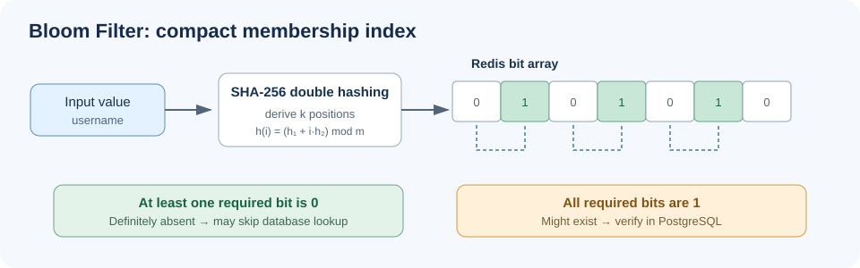
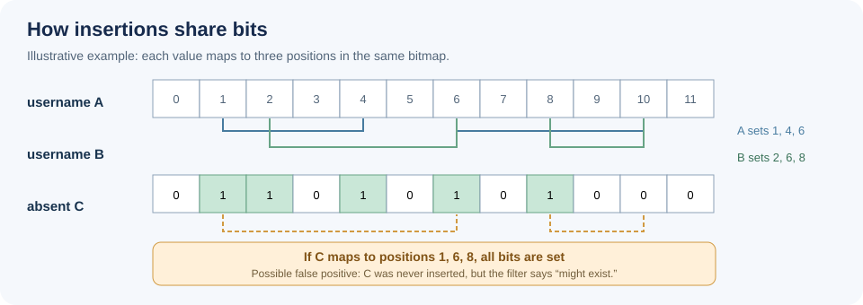

# Bloom Filter Fundamentals

## What is a Bloom Filter?

A Bloom Filter is a space-efficient probabilistic data structure for checking whether a value may belong to a set. It stores no copy of the original values—only a bit array and a procedure for mapping each value to several bit positions.

Its answer is asymmetric:

- If any required bit is `0`, the value is **definitely absent**, provided the filter was built correctly and has not lost data.
- If every required bit is `1`, the value **might be present**. Another value may have set those bits, creating a false positive.

With correct initialization and insert-only updates, a standard Bloom Filter has no false negatives. It trades occasional extra verification for compact storage. Common general uses include username existence checks, cache lookup optimization, duplicate detection, web crawlers, distributed databases, and storage systems. Those examples describe the data structure's general applicability; this project implements username checking.



## The bit array

The filter begins as an array of `m` zero bits. To insert an element, it computes `k` positions and sets those bits to `1`. To query an element, it computes the same positions:

```text
insert(x): for each position p in hashes(x), set bit[p] = 1
query(x):  if any bit[p] == 0, return definitely absent
          otherwise, return might be present
```

The same bit can be selected by several different elements. Insertion only changes zero bits to one; this is why a collision can produce a false positive, and why deleting one element by clearing its bits could accidentally erase information belonging to another element.



## False positives and false negatives

A **false positive** occurs when a never-inserted value maps only to bits that were already set. It does not mean the filter returns a certain membership answer; “might contain” intentionally leaves room for uncertainty.

A **false negative** would mean an inserted value is reported absent. It should not happen when the filter has all relevant insertions, uses the same hashing parameters for writing and reading, and has not been reset or lost. In this application, an incomplete or untrusted Redis filter must therefore not be used to make a negative decision; readiness metadata and PostgreSQL fallback are part of correctness.

## Why use one for username checks?

A direct database query is simple and often appropriate. When a workload generates many existence checks for names that are not registered, a Bloom Filter may cheaply reject some of those requests before the database is queried. A positive still requires PostgreSQL verification. The optimization is valuable only if its overhead and operational complexity fit the workload; this repository's scale experiment measures the in-memory data structure, not a database comparison.

## Sizing the filter

For expected inserted count `n` and target false-positive probability `p`, the standard approximations are:

```text
m = -n ln(p) / (ln 2)^2
k = (m / n) ln 2
```

Here `m` is the number of bits and `k` is the number of hash positions per value. For 100,000 elements and `p = 0.01`, these yield about 958,506 bits and 7 hash positions. The raw bitmap occupies `ceil(m / 8)` bytes, about 119,814 bytes or 117 KiB (using 1 KiB = 1,024 bytes). This excludes Redis key, protocol, and allocator overhead.

Sizing expresses a capacity assumption, not an enforced maximum. With fixed `m`, adding more than `n` elements raises occupancy and the false-positive probability. This implementation does not automatically resize or alert on saturation.

## Expected false-positive probability

An approximate probability after `n` inserted items is:

```text
p ≈ (1 - e^(-kn/m))^k
```

The formula assumes the hash positions behave sufficiently independently. This implementation derives positions by double hashing rather than computing `k` fully independent digests, a common way to reduce hashing work. Measured results can vary because of the finite test set and the particular hashing scheme.

## Hash functions and double hashing

The implementation computes a SHA-256 digest, reads two 32-bit unsigned values (`h1` and `h2`), then derives position `i` as:

```text
position(i) = (h1 + i × h2) mod m
```

Before generating positions, it advances `h2` until `gcd(h2, m) = 1`. This makes the step relatively prime to the bit-array size and prevents a short modular cycle from repeating positions before the configured hash count is reached (subject to the configuration constraint `k ≤ m`). This deterministic mapping must match for every insert and query.

## Deletion and rebuilds

A standard Bloom Filter cannot safely delete individual values because multiple values can set the same bit. Counting Bloom Filters can track counts at additional memory and complexity cost, but this project does not use one. Instead, a full filter can be rebuilt from the authoritative PostgreSQL user table.

## Bloom Filters are not databases

The filter stores neither usernames nor authoritative records. It does not prove that a username is available after a positive response, and it cannot enforce uniqueness in a concurrent signup race. This project delegates final existence checks and uniqueness enforcement to PostgreSQL.

## Where this appears in the project

- `backend/src/bloom-filter/bloom-filter.ts`: in-memory bit array and membership operations.
- `backend/src/bloom-filter/bloom-hash.ts`: SHA-256 based double hashing.
- `backend/src/bloom-filter/redis-bloom-filter.service.ts`: Redis bitmap operations and readiness metadata.
- [Implementation and Failure Handling](03-implementation-and-failure-handling.md): how these pieces interact.
