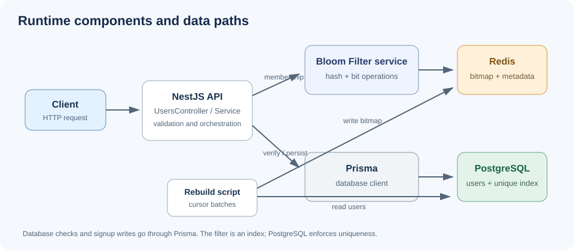
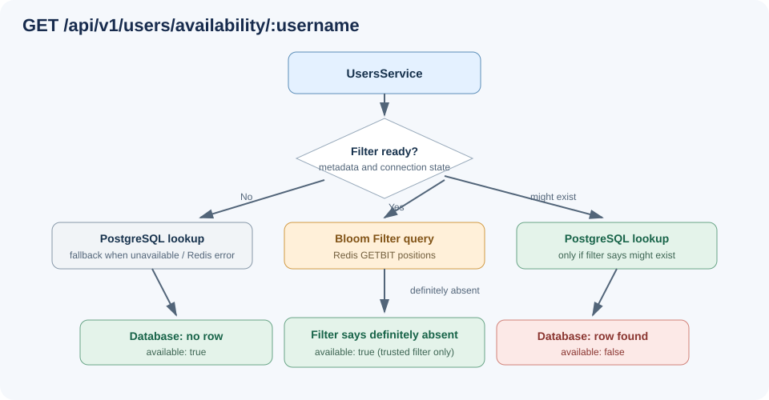
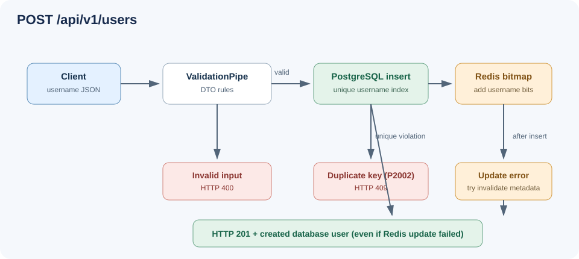

# System Architecture and Data Flow

## Goals

The implementation aims to reduce unnecessary PostgreSQL existence checks, keep PostgreSQL as the source of truth, use Redis for fast shared bit operations, fall back to PostgreSQL when the filter cannot be trusted, and provide a concrete system-design learning exercise.

## Component responsibilities

| Component | Responsibility |
|---|---|
| NestJS | Exposes HTTP endpoints and coordinates user and filter operations |
| Users module | Performs availability checks and signup orchestration |
| Bloom Filter service | Hashes usernames, checks/updates Redis bits, and manages readiness metadata |
| Redis | Stores the username bitmap and metadata |
| Prisma | Provides database queries and migration support |
| PostgreSQL | Persists users and enforces unique usernames |
| Rebuild script | Reconstructs the Redis bitmap from PostgreSQL rows in batches |
| Docker Compose | Starts the three services, networks them, and mounts persistent volumes |

## High-level architecture

The Users service calls the filter first for an availability check. The filter service uses Redis. When the filter returns “might exist,” the Users service checks PostgreSQL; it also queries PostgreSQL if the filter reports not ready or Redis operations fail. Signup writes to PostgreSQL before attempting a Redis bit update. Rebuild is a separate script that reads PostgreSQL and writes Redis.

## Username availability flow

The route is `GET /api/v1/users/availability/:username`:

1. `UsersController` passes the path parameter to `UsersService`.
2. The service asks whether the filter is ready.
3. If ready, a negative Bloom Filter answer returns available immediately.
4. A possible match is checked in PostgreSQL.
5. If readiness is false or Redis throws an error, PostgreSQL performs the lookup instead.
6. PostgreSQL's result determines whether the username is currently available.

The positive path needs verification because false positives are possible. A negative is only safe to trust when the filter represents the relevant user set and its metadata/configuration are compatible.

## Signup flow

1. The global NestJS `ValidationPipe` validates the body against `CreateUserDto`: string, 3–30 characters, letters/digits/underscore only.
2. `UsersService` inserts the username through Prisma.
3. PostgreSQL's unique index on `users.username` protects against duplicates, including concurrent requests.
4. Prisma `P2002` is translated into HTTP 409.
5. After a successful insert, the service adds the username to Redis Bloom Filter.
6. If this update fails, the service attempts to mark the filter invalid, logs errors, and still returns the created database record.

The database write happens first because PostgreSQL is authoritative. Availability checking is advisory and can race; the unique index makes the final decision.

## Initialization and rebuild

There is no startup rebuild hook. The explicit `src/bloom-filter/experiments/rebuild.ts` script creates a Nest application context, marks Redis metadata `building`, deletes the old bitmap, and reads users ordered by id using cursor pagination in batches of 1,000. It adds each page with `addMany()` and sets metadata to `ready` only after the loop completes.

The script catches a failed rebuild and exits unsuccessfully; since `beginRebuild()` set metadata to `building`, a subsequent filter readiness check should reject it. It does not catch the failure and explicitly mark status `invalid`. Readiness metadata prevents an in-progress or mismatched filter from being used as a trustworthy negative index.

## Docker architecture and networking

Compose defines three services: `backend`, `postgres`, and `redis`.

| Service | Container port | Host port |
|---|---:|---:|
| NestJS | 3000 | 3000 |
| PostgreSQL | 5432 | 5433 |
| Redis | 6379 | 6380 |

Within the Compose network, the backend connects to hostnames `postgres:5432` and `redis:6379`. `localhost` inside the backend container refers to the backend container itself. The `.env.example` values (`localhost:5433`, `localhost:6380`) are intended for running the API on the host against the exposed ports.

PostgreSQL and Redis have health checks. Backend startup depends on those services being healthy. Named volumes `postgres_data` and `redis_data` persist service data across ordinary container recreation. The Redis service enables append-only persistence. The backend container runs `prisma migrate deploy` before launching the compiled API.

## Detailed implementation

For Redis commands, failure scenarios, known limitations, and recovery procedure, continue to [Implementation and Failure Handling](03-implementation-and-failure-handling.md).
