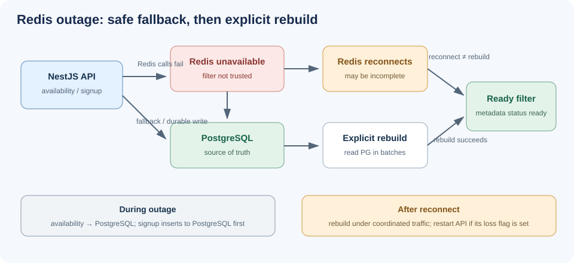

# Implementation and Failure Handling

## Project structure

| Path | Responsibility |
|---|---|
| `src/bloom-filter/bloom-filter.ts` | In-memory bitmap and set/query operations |
| `src/bloom-filter/bloom-hash.ts` | SHA-256 double-hash position generation |
| `src/bloom-filter/redis-bloom-filter.service.ts` | Redis bitmap commands and metadata/readiness lifecycle |
| `src/users/` | API endpoints, signup/availability logic, request DTO |
| `src/redis/` | ioredis client configuration and connection-loss flag |
| `src/prisma/` | Prisma client module/service |
| `prisma/` | PostgreSQL schema and migration |
| `src/bloom-filter/experiments/` | Demonstrations, scale test, and rebuild script |

## In-memory Bloom Filter

`BloomFilter` holds `bitSize`, `hashCount`, a `BloomHash` instance, and a `Uint8Array` sized to `ceil(bitSize / 8)`. Eight positions are packed into each byte. `add()` sets each derived position using byte index `floor(position / 8)` and bit index `position % 8`. `mightContain()` returns true only if every corresponding bit is set. `getBitArray()` returns `.slice()`, so callers receive a copy rather than a mutable reference to internal state.

The standalone class validates its sizing through `BloomHash`: positive integer sizes and hash counts, with hash count no greater than bit size.

## Hashing strategy

`BloomHash` hashes the UTF-8 input with Node's SHA-256 implementation and reads two big-endian 32-bit words from the digest. It creates `k` positions with double hashing:

```text
(h1 + i × h2) mod bitSize, for i = 0 ... k-1
```

The second hash is replaced with 1 if the word is zero, then incremented until its greatest common divisor with `bitSize` is 1. Relative primality avoids a repeating modular sequence with a period shorter than the bit array. Double hashing derives many positions from one digest instead of running many separate hash functions; the values are correlated by construction, not independent digests.

## Redis integration

The Redis adapter uses these keys:

| Key | Contents |
|---|---|
| `bloom-filter:usernames` | Redis string used as the bitmap |
| `bloom-filter:usernames:metadata` | JSON description of the bitmap and readiness |

Each metadata record contains `version`, `bitSize`, `hashCount`, `hashAlgorithm` (`sha256-double-hashing`), and `status`. Status values written by the service are `building`, `ready`, and `invalid`.

For insertion, the adapter generates all positions and sends `SETBIT key position 1` operations through an ioredis pipeline. Lookup pipelines the matching `GETBIT` reads and requires every response to be exactly 0 or 1. Pipelines reduce client/server round trips compared with sending each bit command separately; they do not make the commands transactional. The metadata uses ordinary `GET` and `SET`; rebuild deletes the bitmap with `DEL`.

## Readiness management

`isReady()` first rejects the filter if the current `RedisService` instance has observed a connection close. Otherwise it reads metadata and requires valid JSON with version 1, matching bit size and hash count, the expected algorithm string, and status `ready`. Missing, malformed, incompatible, building, or invalid metadata returns false. A Redis error can throw; availability handling catches that and uses PostgreSQL.

The process-local `connectionLost` flag is set on ioredis `close`. It intentionally treats reconnecting as insufficient evidence that the bitmap is complete. `markConnectionRebuilt()` can clear the flag, but the rebuild script does not call it because its Nest application context is separate from the API process. Consequently, an API process that has observed a close continues to distrust the filter for its lifetime unless the process is restarted. This flag is not shared across replicas and does not coordinate rebuilds.

## PostgreSQL remains authoritative

The Prisma `User` model maps to `users`, with a UUID primary key, username (`VARCHAR(30)`, unique), and creation timestamp. The unique database index—not the Bloom Filter—enforces username uniqueness. Signup catches Prisma's known request error `P2002` and returns Nest's `ConflictException` (HTTP 409).

## Failure scenarios



| Scenario | Current behavior |
|---|---|
| Redis unavailable during availability check | Readiness/lookup may return false or throw. `UsersService` catches filter errors and queries PostgreSQL. |
| Redis unavailable during signup | PostgreSQL insert can succeed. Redis update failure is logged; the service tries to write `invalid` metadata and returns the created user. If Redis cannot be reached, invalidation may fail too. |
| Redis reconnects | ioredis retries with a capped delay, but reconnecting does not prove that all names inserted during an outage are represented. The process-local flag remains set after `close`, so the API uses PostgreSQL fallback. |
| Explicit rebuild | Replaces the bitmap from PostgreSQL batches; metadata is `building` during the run and `ready` after full success. |
| Rebuild fails | The catch sets a nonzero process exit code; metadata generally remains `building` because `beginRebuild()` happened first and no ready mark runs. The API should not trust it. |

## Consistency and concurrency

The availability endpoint reports a snapshot-like answer, not a reservation. Two clients can both see an available name and race to sign up. Both attempt the database insert; PostgreSQL's unique constraint permits at most one, and the other receives HTTP 409. The Bloom Filter is an optimization and can have stale or false-positive answers; database uniqueness protects correctness.

Signup is database-first. If the insert succeeds but Redis update fails, the API still reports successful creation because the durable write already happened. The filter is invalidated when possible; in all cases, the service logs the update error. A process-local close flag also helps prevent the API instance from trusting a bitmap after a known connection interruption.

## Operational recovery

Redis reconnect alone does not backfill missing bits. A cautious recovery sequence is:

1. Confirm PostgreSQL and Redis are healthy.
2. Coordinate a maintenance window or stop API traffic so writes do not race the destructive bitmap replacement. The current implementation has no distributed rebuild lock or snapshot handoff.
3. From `backend/`, run the explicit rebuild:

   ```bash
   npx ts-node src/bloom-filter/experiments/rebuild.ts
   ```

4. Confirm the process reports successful completion and the number of indexed usernames.
5. Restart the API process if it had observed a Redis connection close; this clears its process-local connection-loss flag. If the application is in Docker, restart the backend after rebuilding with a command such as `docker restart bloom-filter-backend`.
6. Verify availability behavior through the API and inspect Swagger at <http://localhost:3000/api/docs>.

The script uses the configured `DATABASE_URL`, `REDIS_HOST`, `REDIS_PORT`, `BLOOM_FILTER_BIT_SIZE`, and `BLOOM_FILTER_HASH_COUNT`. When running on the host with Compose dependencies, use host port values. Do not run the backend and rebuild with different parameters: metadata compatibility checks will refuse the filter.

## Engineering trade-offs

- **Bloom Filter vs direct query:** may save database work for negative checks, but adds Redis calls, metadata, consistency concerns, and operational recovery.
- **Redis vs process memory:** Redis shares state across API instances and persists with configured storage; it also introduces a network dependency. The code's process-local connection-loss flag still limits coordinated behavior.
- **Database as source of truth:** an extra lookup is required for positive filter answers, while PostgreSQL owns the actual user record and uniqueness guarantee.
- **False positives vs memory:** the configured 1% target and capacity trade bitmap memory for extra database verification as the filter fills.
- **Double hashing vs independent hashes:** fewer digest computations with generated positions, with a standard approximation rather than truly independent hash functions.
- **Batch rebuilding vs one full read:** cursor pagination bounds each fetched page at 1,000 users; the bitmap replacement still needs operational coordination with writes.
- **Optimization vs complexity:** the filter is only useful if observed workload and latency justify keeping it correct and rebuilding it.

## Known limitations

- Fixed bit-array parameters; resizing and saturation monitoring are absent.
- Individual deletion is unsupported.
- Rebuilding is an explicit script, not automatic on startup or reconnect.
- The rebuild can race API writes without operator coordination; no lock, snapshot, or dual-write protocol exists.
- A failed rebuild stays `building` rather than explicitly writing `invalid`.
- Connection-loss tracking is process-local. `markConnectionRebuilt()` is defined but unused by the rebuild script.
- Multiple replicas do not share the connection-loss flag and are not coordinated during invalidation or rebuilding.
- A rebuild script's success only confirms its own pass; the current code does not expose a dedicated readiness endpoint or automated validation of completeness.
